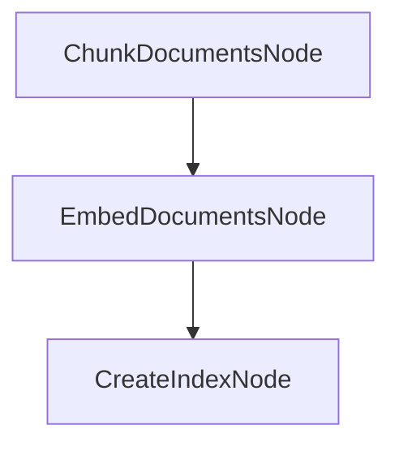
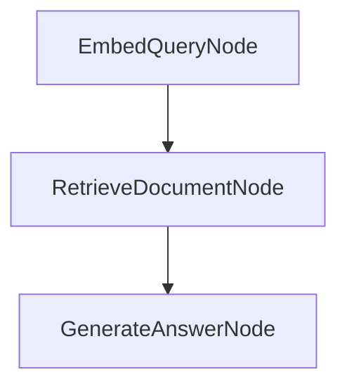

# Retrieval Augmented Generation (RAG)

This tutorial shows how to build a simple RAG system with PocketFlow. It takes a set of documents, splits them into chunks, creates embeddings, stores them in a FAISS index, and then answers user questions by retrieving the most relevant chunks first.

This tutorial is based on: [Retrieval Augmented Generation (RAG) from Scratch — Tutorial For Dummies](https://zacharyhuang.substack.com/p/retrieval-augmented-generation-rag).

## What you will learn

- How to split long documents into smaller chunks.
- How to embed document chunks and user queries.
- How to build a FAISS index for fast retrieval.
- How PocketFlow separates indexing from question answering.

## How to run

### 1) Set your API key

Set your OpenAI API key in the terminal:

```bash
export OPENAI_API_KEY="your-api-key-here"
```

If you prefer, you can update it directly in `utils.py`.

To verify that your API key works, run:

```bash
python utils.py
```

### 2) Install dependencies

Install the dependencies required by this tutorial:

```bash
pip install -r requirements.txt
```

### 3) Run the app

Run the default example:

```bash
python main.py
```

### 4) Ask your own question

After the app starts, try a question like:

> How does the Q-Mesh protocol achieve high transaction speeds?

If your version of `main.py` supports passing a query from the command line, use the format defined in the code. Otherwise, edit the query input in the script and run it again.

## How it works

This tutorial has **two separate stages**:

### Offline stage: build the index

This stage runs before any question is asked.



- **ChunkDocumentsNode**: breaks documents into smaller pieces so they are easier to search.
- **EmbedDocumentsNode**: converts each chunk into a vector embedding.
- **CreateIndexNode**: stores the embeddings in a FAISS index for fast similarity search.

### Online stage: answer questions

This stage runs every time a user asks a question.



- **EmbedQueryNode**: converts the user’s question into the same vector space as the documents.
- **RetrieveDocumentNode**: finds the most relevant chunk using vector similarity search.
- **GenerateAnswerNode**: uses the retrieved chunk and the user’s question to generate the final answer.

## Why PocketFlow helps

PocketFlow keeps the tutorial simple by splitting the workflow into small nodes. That makes the RAG process easier to understand, debug, and extend.

It also makes the flow structure very clear:

- The **offline stage** prepares knowledge.
- The **online stage** uses that knowledge to answer questions.

## Example output

```text
✅ Created 5 chunks from 5 documents
✅ Created 5 document embeddings
🔍 Creating search index...
✅ Index created with 5 vectors
🔍 Embedding query: How to install PocketFlow?
🔎 Searching for relevant documents...
📄 Retrieved document (index: 0, distance: 0.3427)
📄 Most relevant text: "Pocket Flow is a 100-line minimalist LLM framework
        Lightweight: Just 100 lines. Zero bloat, zero dependencies, zero vendor lock-in.
        Expressive: Everything you love—(Multi-)Agents, Workflow, RAG, and more.
        Agentic Coding: Let AI Agents (e.g., Cursor AI) build Agents—10x productivity boost!
        To install, pip install pocketflow or simply copy the source code."
🤖 Generated Answer:
To install PocketFlow, use `pip install pocketflow` or copy the source code.
```

## Notes

- Rebuild the index if the document set changes.
- The offline stage only needs to run when your source documents change.
- The online stage runs each time a user asks a new question.
