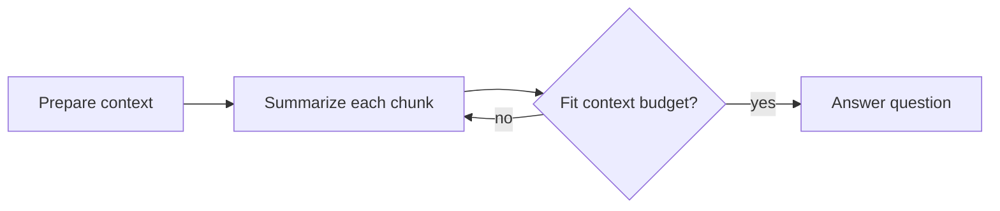

# Recursive Language Model (RLM)

This cookbook addresses [Issue #140](https://github.com/The-Pocket/PocketFlow/issues/140)
with a small, testable example of the Recursive Language Model pattern.

An RLM keeps the full document outside the model's prompt. PocketFlow first
maps a sub-call over bounded chunks, then recursively compresses the resulting
summaries until they fit a configured context budget. A final sub-call answers
the question from the compressed context. This is a practical map-compress-
answer approximation of the RLM idea and does not require a vector database.

## Run it

```bash
pip install -r requirements.txt
export OPENAI_API_KEY=your_api_key_here
python main.py path/to/document.txt "What are the key decisions?"
```

Tune `--chunk-size`, `--max-context-chars`, and `--max-levels` for the model and
document. The tests replace the LLM adapter with a deterministic fake, so no
API key or network access is needed to verify the flow.

## Flow



The long input remains in `shared["document"]`; only `chunks` and `summaries`
are passed to model calls. `max_levels` is a safety bound that prevents an
unexpectedly large input or model response from causing an unbounded loop.

## Files

- `nodes.py`: preparation, map, and recursive reduce/finish nodes
- `flow.py`: PocketFlow graph assembly
- `utils.py`: OpenAI adapter, isolated for testing
- `main.py`: command-line entry point
- `tests/test_rlm.py`: offline unit tests for chunking and recursion
