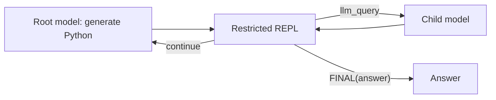

# Recursive Language Model (RLM)

This cookbook addresses [Issue #140](https://github.com/The-Pocket/PocketFlow/issues/140)
with a minimal Recursive Language Model workflow.

Unlike a fixed map-reduce pipeline, the root model receives only metadata about
the long context. It writes a small Python program that can inspect the external
`context` variable, call `llm_query(prompt)` on focused excerpts, and finish by
calling `FINAL(answer)`. PocketFlow loops between the root model and the REPL
until an answer is produced or the iteration limit is reached.

## Run it

```bash
pip install -r requirements.txt
export OPENAI_API_KEY=your_api_key_here
python main.py path/to/document.txt "What are the key decisions?"
```

The root prompt never embeds the complete document. The model decides which
slices to inspect, so the example demonstrates external-context exploration and
recursive sub-model calls rather than a predetermined chunking strategy.

Options:

- `--max-iterations`: maximum root-model turns; returns a bounded fallback if no `FINAL` is produced;
- `--max-code-chars`: maximum generated program and child-query size.

## Flow



The REPL exposes only `context`, `llm_query`, `FINAL`, `print`, and a small set
of safe built-ins. Imports, filesystem/network access, attribute access, and
unbounded `while` loops are rejected. This is an educational in-process guard,
not a production security sandbox; use a separate process or container for
untrusted model output.

## Files

- `nodes.py`: root-model and REPL nodes with PocketFlow transitions
- `repl.py`: AST validation and restricted execution environment
- `flow.py`: root ↔ REPL loop assembly
- `utils.py`: OpenAI-compatible adapter, isolated for testing
- `main.py`: command-line entry point
- `tests/test_rlm.py`: offline tests for recursion, isolation, and termination
