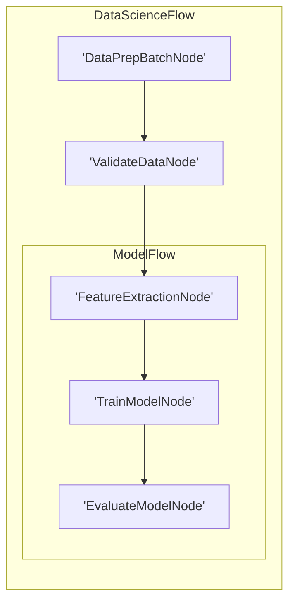

# Visualization and Debugging

Similar to LLM wrappers, we **don't** provide built-in visualization and debugging. Here, we recommend some *minimal* (and incomplete) implementations These examples can serve as a starting point for your own tooling.

## 1. Visualization with Mermaid

This code recursively traverses the nested graph, assigns unique IDs to each node, and treats Flow nodes as subgraphs to generate Mermaid syntax for a hierarchical visualization. Successors are traversed with their action names, so conditional links appear as labeled Mermaid edges (for example, `A -->|yes| B`); links without an action remain unlabeled.


```python
def build_mermaid(start):
    ids, visited, lines = {}, set(), ["graph LR"]
    emitted_links = set()
    ctr = 1

    def get_id(node):
        nonlocal ctr
        if node not in ids:
            ids[node] = f"N{ctr}"
            ctr += 1
        return ids[node]

    def link(source, target, action=None):
        edge = (source, target, action)
        if edge in emitted_links:
            return
        emitted_links.add(edge)
        if action:
            lines.append(f"    {source} -->|{action}| {target}")
        else:
            lines.append(f"    {source} --> {target}")

    def walk(node, parent=None, action=None):
        node_id = get_id(node)
        if node in visited:
            if parent:
                link(parent, node_id, action)
            return
        visited.add(node)

        if isinstance(node, Flow):
            if node.start_node:
                if parent:
                    link(parent, get_id(node.start_node), action)
                lines.append(
                    f"\\n    subgraph sub_flow_{node_id}[{type(node).__name__}]"
                )
                walk(node.start_node)
                for next_action, next_node in node.successors.items():
                    walk(next_node, get_id(node.start_node), next_action)
                lines.append("    end\\n")
        else:
            lines.append(f"    {node_id}['{type(node).__name__}']")
            if parent:
                link(parent, node_id, action)
            for next_action, next_node in node.successors.items():
                walk(next_node, node_id, next_action)

    walk(start)
    return "\\n".join(lines)
```



For example, suppose we have a complex Flow for data science:

```python
class DataPrepBatchNode(BatchNode):
    def prep(self,shared): return []
class ValidateDataNode(Node): pass
class FeatureExtractionNode(Node): pass
class TrainModelNode(Node): pass
class EvaluateModelNode(Node): pass
class ModelFlow(Flow): pass
class DataScienceFlow(Flow):pass

feature_node = FeatureExtractionNode()
train_node = TrainModelNode()
evaluate_node = EvaluateModelNode()
feature_node >> train_node >> evaluate_node
model_flow = ModelFlow(start=feature_node)
data_prep_node = DataPrepBatchNode()
validate_node = ValidateDataNode()
data_prep_node >> validate_node >> model_flow
data_science_flow = DataScienceFlow(start=data_prep_node)
result = build_mermaid(start=data_science_flow)
```

The code generates a Mermaid diagram:



For visualization based on d3.js, check out [the cookbook](https://github.com/The-Pocket/PocketFlow/tree/main/cookbook/pocketflow-visualization).

## 2. Call Stack Debugging

It would be useful to print the Node call stacks for debugging. This can be achieved by inspecting the runtime call stack:

```python
import inspect

def get_node_call_stack():
    stack = inspect.stack()
    node_names = []
    seen_ids = set()
    for frame_info in stack[1:]:
        local_vars = frame_info.frame.f_locals
        if 'self' in local_vars:
            caller_self = local_vars['self']
            if isinstance(caller_self, BaseNode) and id(caller_self) not in seen_ids:
                seen_ids.add(id(caller_self))
                node_names.append(type(caller_self).__name__)
    return node_names
```

For example, suppose we have a complex Flow for data science:

```python
class DataPrepBatchNode(BatchNode): 
    def prep(self, shared): return []
class ValidateDataNode(Node): pass
class FeatureExtractionNode(Node): pass
class TrainModelNode(Node): pass
class EvaluateModelNode(Node): 
    def prep(self, shared):
        stack = get_node_call_stack()
        print("Call stack:", stack)
class ModelFlow(Flow): pass
class DataScienceFlow(Flow):pass

feature_node = FeatureExtractionNode()
train_node = TrainModelNode()
evaluate_node = EvaluateModelNode()
feature_node >> train_node >> evaluate_node
model_flow = ModelFlow(start=feature_node)
data_prep_node = DataPrepBatchNode()
validate_node = ValidateDataNode()
data_prep_node >> validate_node >> model_flow
data_science_flow = DataScienceFlow(start=data_prep_node)
data_science_flow.run({})
```

The output would be: `Call stack: ['EvaluateModelNode', 'ModelFlow', 'DataScienceFlow']`

For a more complete implementation, check out [the cookbook](https://github.com/The-Pocket/PocketFlow/tree/main/cookbook/pocketflow-tracing).